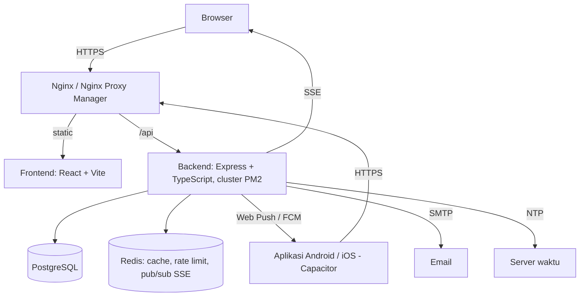

# Catering Management System

[English](README.md) · **Bahasa Indonesia**

Sistem pemesanan makan dan pengambilan di kantin untuk karyawan perusahaan. Karyawan memesan makan sesuai shift kerja dari web atau aplikasi mobile, petugas kantin melayani pengambilan dengan memindai QR code, vendor memantau jumlah pengambilan secara langsung, dan admin mengatur shift, kantin, menu, aturan batas pemesanan, serta kebijakan no-show. Rilis saat ini: 2.8.1. Antarmukanya berbahasa Indonesia.


## Daftar isi

- [Fitur](#fitur)
- [Peran pengguna](#peran-pengguna)
- [Arsitektur](#arsitektur)
- [Teknologi](#teknologi)
- [Memulai](#memulai)
- [Konfigurasi](#konfigurasi)
- [Deployment](#deployment)
- [Aplikasi mobile](#aplikasi-mobile)
- [Penanganan waktu](#penanganan-waktu)
- [Pengujian dan verifikasi](#pengujian-dan-verifikasi)
- [Struktur proyek](#struktur-proyek)
- [Dokumentasi](#dokumentasi)
- [Lisensi](#lisensi)

## Fitur

### Pemesanan

- Setiap pesanan terikat pada tanggal, shift, dan kantin, serta mendapat QR code unik.
- Dua mode batas pemesanan (cutoff): per shift (X hari dan Y jam sebelum shift dimulai) atau mingguan (hari dan jam cutoff, daftar hari yang bisa dipesan, dan jumlah minggu ke depan).
- Pemesanan massal untuk beberapa hari sekaligus.
- Jam istirahat khusus per hari untuk setiap shift. Hari libur dan hari Minggu bisa memblokir pemesanan untuk satu shift atau seharian penuh.
- Kapasitas kantin dijaga di dalam transaksi serializable, sehingga dua karyawan tidak bisa mengambil slot terakhir bersamaan.
- Mode kiosk untuk PC bersama di kantin, dengan preferensi kantin terkunci, pilihan beberapa hari, pembatalan pesanan, dan pemesanan hanya untuk tanggal mendatang.
- Menu mingguan dan item menu yang dikelola per vendor.

### Pengambilan

- Petugas kantin memindai QR pesanan dengan kamera atau barcode scanner. Check-in mengubah status pesanan dari `ORDERED` menjadi `PICKED_UP` dan terlindung dari pemindaian ganda.
- Foto saat check-in bersifat opsional dan diperkecil di server.
- Antrean langsung diperbarui melalui server-sent events (SSE).

### Kebijakan dan akuntabilitas

- Pemrosesan no-show berjalan terjadwal. Strike bertambah di `noShowCount`, dan pengguna otomatis masuk blacklist setelah jumlah strike tertentu yang bisa diatur.
- Auto-blacklist bisa dimatikan. Saat mati, pesanan tetap ditandai `NO_SHOW` untuk catatan, tetapi strike tidak bertambah. Menyalakannya kembali membutuhkan password admin dan mereset strike semua pengguna ke nol.
- Pengelolaan blacklist manual dan audit log lengkap untuk perubahan pesanan, pengguna, dan pengaturan.

### Administrasi dan laporan

- Perusahaan, divisi, departemen, shift, kantin, vendor, dan pengguna, dengan impor pengguna dari Excel memakai template yang bisa diunduh.
- Statistik harian dan per rentang tanggal, dashboard realtime, serta ekspor Excel (exceljs) dengan paginasi berbasis cursor untuk data besar.
- Pengumuman, pesan langsung, dan notifikasi email.
- Notifikasi Web Push dan Firebase Cloud Messaging, ditambah pengingat lokal di aplikasi mobile.
- Waktu tersinkron NTP dengan zona waktu yang bisa diatur, riwayat uptime server, dan backup database dari panel admin.
- Rotasi refresh token opsional dengan pencabutan per keluarga token, bisa diaktifkan dari UI admin atau dengan `ENABLE_TOKEN_ROTATION`.

## Peran pengguna

| Peran | Akses |
|---|---|
| `ADMIN` | Seluruh konfigurasi, pengguna, laporan, kebijakan, dan semua yang bisa dilakukan petugas kantin serta vendor |
| `CANTEEN` | Check-in lewat QR atau manual, antrean langsung, verifikasi foto |
| `VENDOR` | Halaman vendor yang hanya bisa dibaca: ringkasan mingguan dan statistik pengambilan. Vendor tidak bisa membuat pesanan |
| `USER` | Pesanan sendiri, riwayat, dan profil |

Pengguna dengan tanda `mustChangePassword` hanya bisa membuka layar ganti password sampai password baru diatur.

## Arsitektur



Header keamanan (HSTS, CSP, X-Frame-Options) dipasang di proxy, bukan di Express.

## Teknologi

| Lapisan | Teknologi |
|---|---|
| Backend | Node.js, Express, TypeScript, Prisma, PostgreSQL, Redis, node-cron, PM2 |
| Autentikasi | Access token JWT (HS256, issuer tetap) dan refresh token yang di-hash serta bisa dicabut |
| Notifikasi | web-push, firebase-admin (FCM), nodemailer, SSE |
| File dan laporan | sharp, exceljs |
| Frontend | React 18, Vite, TypeScript, Tailwind CSS, React Context |
| Mobile | Capacitor (Android dan iOS), push native, notifikasi lokal |
| Pengujian | Vitest (unit test backend), skrip regresi keamanan berbasis curl |

## Memulai

### Development lokal

Prasyarat: Node.js 18 atau lebih baru, PostgreSQL, dan Redis.

```bash
# Backend
cd backend
cp .env.example .env          # isi DATABASE_URL, secret JWT, REDIS_URL, CORS_ORIGIN
npm install
npm run prisma:migrate
npm run prisma:seed
npm run dev                   # http://localhost:3012

# Frontend (terminal kedua)
cd frontend
cp .env.example .env
npm install
npm run dev                   # http://localhost:3011
```

Skrip seed membuat akun admin awal, shift, dan data contoh. ID admin dan password awal ada di `backend/prisma/seed.ts`; ganti password setelah login pertama.

Health check tersedia di `GET /api/health`.

### Docker

```bash
cp docker-compose.example.yml docker-compose.yml

cat > .env << 'EOF'
DB_PASSWORD=ganti-saya
JWT_SECRET=ganti-saya-minimal-32-karakter
EOF
chmod 600 .env

docker compose up -d --build
```

Stack contoh menjalankan PostgreSQL (port host 3013), Redis, backend (3012, internal), frontend (3011, internal), dan Nginx di port 8443. Isi `CORS_ORIGIN` di file compose dengan origin situs yang sebenarnya sebelum start; backend menolak berjalan bila nilainya wildcard `*`.

## Konfigurasi

Backend (`backend/.env`):

| Variabel | Keterangan |
|---|---|
| `DATABASE_URL` | Connection string PostgreSQL |
| `DB_USER`, `DB_PASSWORD`, `DB_PORT`, `DB_NAME` | Pengaturan database untuk Docker dan skrip |
| `JWT_SECRET`, `JWT_REFRESH_SECRET` | Secret penandatangan token, minimal 32 karakter |
| `PORT` | Port backend (3012) |
| `CORS_ORIGIN` | Origin yang diizinkan, atau daftar dipisah koma. Wildcard ditolak |
| `REDIS_URL` | Koneksi Redis |
| `ENABLE_TOKEN_ROTATION` | `true` mengaktifkan rotasi refresh token. Default `false` |
| `BACKUP_DIR` | Folder untuk backup database |
| `VAPID_PUBLIC_KEY`, `VAPID_PRIVATE_KEY` | Key Web Push |
| `NODE_ENV` | `development` atau `production` |

Frontend (`frontend/.env`): `VITE_VAPID_PUBLIC_KEY`. `VITE_API_URL` dikosongkan untuk build web same-origin dan diisi di `.env.capacitor` untuk build native.

## Deployment

| File | Kegunaan |
|---|---|
| [DEPLOY.md](DEPLOY.md) | Instalasi server langkah demi langkah dengan Docker |
| [DEPLOY-LINUX-NPM.md](DEPLOY-LINUX-NPM.md), `deploy-linux.sh`, `docker-compose.npm.yml` | Deployment Linux di belakang Nginx Proxy Manager |
| [DEPLOY-NPM.md](DEPLOY-NPM.md) | Pengaturan Nginx Proxy Manager |
| `backend/PM2_DEPLOYMENT.md` | Menjalankan backend dengan PM2 mode cluster |
| `update.sh`, `update.ps1` | Update satu langkah: backup database, pull, rebuild, restart |
| `docs/ganti-domain.md` | Memindahkan aplikasi ke domain baru |

Rilis 2.7.0 menyetel stack untuk sekitar 5.000 pengguna per hari: pengaturan memori PostgreSQL dan Redis, cluster PM2 dua worker, batas koneksi SSE, perlindungan cache stampede, serta pemrosesan no-show dan pembatalan secara batch. Detailnya ada di [CHANGELOG.md](CHANGELOG.md).

## Aplikasi mobile

Frontend dibungkus dengan Capacitor.

```bash
cd frontend
npm run cap:build          # build + sync Android
npm run cap:build:ios      # build + sync iOS
```

`build-android.ps1`, `build-apk-jdk17.ps1`, dan `build-ios.sh` membangun paket yang siap dipasang, dan [IOS_SETUP.md](IOS_SETUP.md) menjelaskan toolchain iOS. Build native memuat `.env.capacitor` melalui `vite build --mode capacitor`. Di Android 15 ke atas, konten aplikasi diberi jarak di bawah status bar.

## Penanganan waktu

Backend berjalan dengan `TZ=UTC` dan menyimpan nilai "shifted UTC", yaitu jam dinding lokal yang dikonfigurasi lalu ditulis ke field UTC. Frontend menampilkan nilai tersebut apa adanya tanpa konversi ulang. Di kode, selalu gunakan helper di `backend/src/services/time.service.ts` dan `backend/src/utils/orderDate.ts` (backend) serta `frontend/src/utils/dateHelpers.ts` dan `timezone.ts` (frontend), bukan `new Date()`. Penjelasan lengkap ada di [CLAUDE.md](CLAUDE.md).

## Pengujian dan verifikasi

```bash
cd backend && npm test        # unit test Vitest (tanggal pesanan, guard vendor, kapasitas, pesanan massal)
cd backend && npm run build   # build TypeScript
cd frontend && npm run build && npm run lint
```

`scripts/security-regression-test.sh` adalah skrip curl black-box yang memeriksa perbaikan keamanan sebelumnya, yang dirujuk di komentar kode dengan ID seperti `F-006` dan `R-001`.

## Struktur proyek

```
backend/
  prisma/              skema, migrasi, seed
  src/
    index.ts           aplikasi Express, router, graceful shutdown
    routes/            satu router per domain; pesanan dipecah di order/ (list, create, bulk, checkin, cancel, admin, stats)
    services/          waktu, cache, redis, audit, scheduler, notifikasi, rate limiter
    middleware/        auth, guard ganti password, guard peran, cutoff, blacklist
    utils/             helper tanggal pesanan, flag environment
frontend/
  src/                 halaman, context (Auth, SSE), utilitas
  android/, ios/       proyek native Capacitor
nginx/                 konfigurasi reverse proxy
scripts/               skrip pemeliharaan dan regresi keamanan
docs/                  catatan desain, review, catatan deployment
```

## Dokumentasi

- [CHANGELOG.md](CHANGELOG.md): riwayat rilis
- [BLUEPRINT.md](BLUEPRINT.md): blueprint sistem
- [TABLE_STRUCTURE.md](TABLE_STRUCTURE.md): struktur tabel database
- [docs/REFRESH_TOKEN_SETUP.md](docs/REFRESH_TOKEN_SETUP.md): rotasi refresh token

## Lisensi

Dirilis di bawah [Lisensi MIT](LICENSE).

Dikembangkan dan dikelola oleh Yohanes Octavian Rizky ([@torpedoliar](https://github.com/torpedoliar)).
