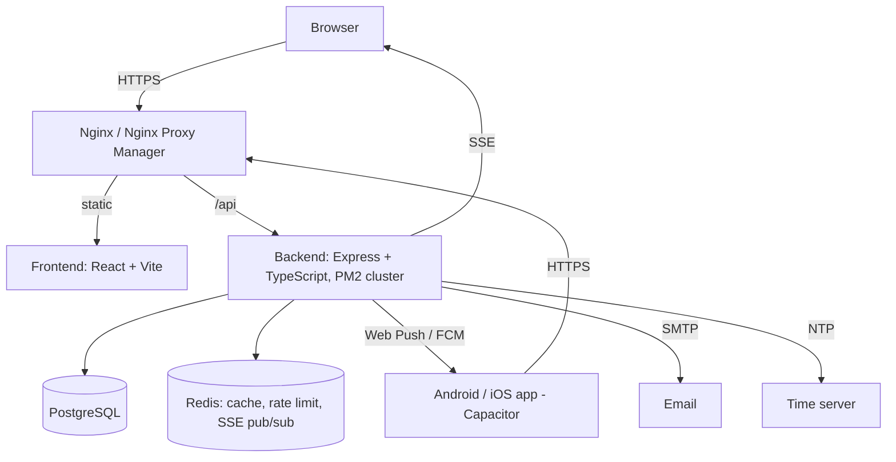

# Catering Management System

**English** · [Bahasa Indonesia](README.id.md)

A meal ordering and canteen pickup system for company employees. Employees order meals for their work shift from the web or the mobile app, canteen staff check orders out by scanning a QR code, vendors follow pickup numbers in real time, and administrators manage shifts, canteens, menus, cutoff rules, and no-show policy. Current release: 2.8.1. The interface is in Indonesian.


## Contents

- [Features](#features)
- [Roles](#roles)
- [Architecture](#architecture)
- [Tech stack](#tech-stack)
- [Getting started](#getting-started)
- [Configuration](#configuration)
- [Deployment](#deployment)
- [Mobile apps](#mobile-apps)
- [Time handling](#time-handling)
- [Testing and verification](#testing-and-verification)
- [Project layout](#project-layout)
- [Documentation](#documentation)
- [License](#license)

## Features

### Ordering

- Orders are tied to a date, a shift, and a canteen. Each order gets a unique QR code.
- Two cutoff modes: per shift (X days and Y hours before the shift starts) or weekly (a cutoff day and hour, a set of orderable weekdays, and a number of weeks ahead).
- Bulk ordering for several days in one action.
- Day-specific break times per shift, holidays, and Sundays can block ordering for one shift or the whole day.
- Canteen capacity is enforced inside a serializable transaction, so two employees cannot take the last slot at the same time.
- Kiosk mode for a shared PC in the canteen, with a locked canteen preference, multi-day selection, cancellation, and ordering limited to future dates.
- Weekly menus and menu items managed per vendor.

### Pickup

- Canteen staff scan the order QR code with a camera or a barcode scanner. Check-in moves an order from `ORDERED` to `PICKED_UP` and is protected against double scans.
- Optional check-in photo, resized on the server.
- The live queue updates through server-sent events (SSE).

### Policy and accountability

- No-show processing runs on a schedule. Strikes accumulate in `noShowCount`, and a user is blacklisted automatically after a configurable number of strikes.
- Auto-blacklist can be switched off. When it is off, orders are still marked `NO_SHOW` for the record, but strikes do not increase. Turning it back on requires the admin password and resets every user's strikes to zero.
- Manual blacklist management and a full audit log of order, user, and settings changes.

### Administration and reporting

- Companies, divisions, departments, shifts, canteens, vendors, and users, with Excel user import from a downloadable template.
- Daily and range statistics, a real-time dashboard, and Excel export (exceljs) with cursor-based paging for large datasets.
- Announcements, direct messages, and email notifications.
- Web Push and Firebase Cloud Messaging notifications, plus local reminders in the mobile app.
- NTP-synchronized time with a configurable timezone, server uptime history, and database backups from the admin panel.
- Optional refresh-token rotation with family revocation, switchable from the admin UI or with `ENABLE_TOKEN_ROTATION`.

## Roles

| Role | Access |
|---|---|
| `ADMIN` | Full configuration, users, reports, policies, and everything canteen and vendor staff can do |
| `CANTEEN` | QR and manual check-in, live queue, photo verification |
| `VENDOR` | Read-only vendor pages: weekly summary and pickup statistics. Vendors cannot create orders |
| `USER` | Own orders, history, and profile |

Users flagged with `mustChangePassword` can only reach the password change screen until they set a new password.

## Architecture



Security headers (HSTS, CSP, X-Frame-Options) are set at the proxy, not in Express.

## Tech stack

| Layer | Technology |
|---|---|
| Backend | Node.js, Express, TypeScript, Prisma, PostgreSQL, Redis, node-cron, PM2 |
| Auth | JWT access tokens (HS256, pinned issuer) and hashed, revocable refresh tokens |
| Notifications | web-push, firebase-admin (FCM), nodemailer, SSE |
| Files and reports | sharp, exceljs |
| Frontend | React 18, Vite, TypeScript, Tailwind CSS, React Context |
| Mobile | Capacitor (Android and iOS), native push, local notifications |
| Tests | Vitest (backend unit tests), curl-based security regression script |

## Getting started

### Local development

Requirements: Node.js 18 or newer, PostgreSQL, and Redis.

```bash
# Backend
cd backend
cp .env.example .env          # set DATABASE_URL, JWT secrets, REDIS_URL, CORS_ORIGIN
npm install
npm run prisma:migrate
npm run prisma:seed
npm run dev                   # http://localhost:3012

# Frontend (second terminal)
cd frontend
cp .env.example .env
npm install
npm run dev                   # http://localhost:3011
```

The seed script creates the initial admin accounts, shifts, and sample data. The admin IDs and the initial password are in `backend/prisma/seed.ts`; change the password after the first login.

The health check is `GET /api/health`.

### Docker

```bash
cp docker-compose.example.yml docker-compose.yml

cat > .env << 'EOF'
DB_PASSWORD=change-me
JWT_SECRET=change-me-at-least-32-characters
EOF
chmod 600 .env

docker compose up -d --build
```

The example stack runs PostgreSQL (host port 3013), Redis, the backend (3012, internal), the frontend (3011, internal), and Nginx on port 8443. Set `CORS_ORIGIN` in the compose file to the real origin of your site before starting; the backend refuses to boot with a `*` wildcard.

## Configuration

Backend (`backend/.env`):

| Variable | Description |
|---|---|
| `DATABASE_URL` | PostgreSQL connection string |
| `DB_USER`, `DB_PASSWORD`, `DB_PORT`, `DB_NAME` | Database settings used by Docker and scripts |
| `JWT_SECRET`, `JWT_REFRESH_SECRET` | Token signing secrets, at least 32 characters |
| `PORT` | Backend port (3012) |
| `CORS_ORIGIN` | Allowed origin, or a comma-separated list. A wildcard is refused |
| `REDIS_URL` | Redis connection |
| `ENABLE_TOKEN_ROTATION` | `true` enables refresh-token rotation. Default `false` |
| `BACKUP_DIR` | Folder for database backups |
| `VAPID_PUBLIC_KEY`, `VAPID_PRIVATE_KEY` | Web Push keys |
| `NODE_ENV` | `development` or `production` |

Frontend (`frontend/.env`): `VITE_VAPID_PUBLIC_KEY`. `VITE_API_URL` is empty for same-origin web builds and set in `.env.capacitor` for native builds.

## Deployment

| File | Use |
|---|---|
| [DEPLOY.md](DEPLOY.md) | Step-by-step server installation with Docker |
| [DEPLOY-LINUX-NPM.md](DEPLOY-LINUX-NPM.md), `deploy-linux.sh`, `docker-compose.npm.yml` | Linux deployment behind Nginx Proxy Manager |
| [DEPLOY-NPM.md](DEPLOY-NPM.md) | Nginx Proxy Manager setup |
| `backend/PM2_DEPLOYMENT.md` | Running the backend with PM2 in cluster mode |
| `update.sh`, `update.ps1` | One-step update: back up the database, pull, rebuild, restart |
| `docs/ganti-domain.md` | Moving the application to a new domain |

The 2.7.0 release tuned the stack for about 5,000 users per day: PostgreSQL and Redis memory settings, a two-worker PM2 cluster, SSE connection caps, cache stampede protection, and batched no-show and cancel processing. See [CHANGELOG.md](CHANGELOG.md) for details.

## Mobile apps

The frontend is wrapped with Capacitor.

```bash
cd frontend
npm run cap:build          # build + sync Android
npm run cap:build:ios      # build + sync iOS
```

`build-android.ps1`, `build-apk-jdk17.ps1`, and `build-ios.sh` build installable packages, and [IOS_SETUP.md](IOS_SETUP.md) covers the iOS toolchain. Native builds load `.env.capacitor` through `vite build --mode capacitor`. On Android 15 and later, the app insets its content below the status bar.

## Time handling

The backend runs with `TZ=UTC` and stores "shifted UTC" values: the configured local wall-clock time written into UTC fields. The frontend shows these values as they are, without converting them again. In code, always use the helpers in `backend/src/services/time.service.ts` and `backend/src/utils/orderDate.ts` (backend) and `frontend/src/utils/dateHelpers.ts` and `timezone.ts` (frontend) instead of `new Date()`. [CLAUDE.md](CLAUDE.md) explains the model in detail.

## Testing and verification

```bash
cd backend && npm test        # Vitest unit tests (order dates, vendor guard, capacity, bulk orders)
cd backend && npm run build   # TypeScript build
cd frontend && npm run build && npm run lint
```

`scripts/security-regression-test.sh` is a black-box curl script that checks earlier security fixes, referenced in code comments by IDs such as `F-006` and `R-001`.

## Project layout

```
backend/
  prisma/              schema, migrations, seed
  src/
    index.ts           Express app, routers, graceful shutdown
    routes/            one router per domain; orders split into order/ (list, create, bulk, checkin, cancel, admin, stats)
    services/          time, cache, redis, audit, scheduler, notifications, rate limiter
    middleware/        auth, password-change guard, role guards, cutoff, blacklist
    utils/             order date helpers, env flags
frontend/
  src/                 pages, contexts (Auth, SSE), utils
  android/, ios/       Capacitor native projects
nginx/                 reverse proxy configuration
scripts/               maintenance and security regression scripts
docs/                  design notes, reviews, deployment notes
```

## Documentation

- [CHANGELOG.md](CHANGELOG.md): release history
- [BLUEPRINT.md](BLUEPRINT.md): system blueprint
- [TABLE_STRUCTURE.md](TABLE_STRUCTURE.md): database tables
- [docs/REFRESH_TOKEN_SETUP.md](docs/REFRESH_TOKEN_SETUP.md): refresh-token rotation

## License

Released under the [MIT License](LICENSE).

Developed and maintained by Yohanes Octavian Rizky ([@torpedoliar](https://github.com/torpedoliar)).
